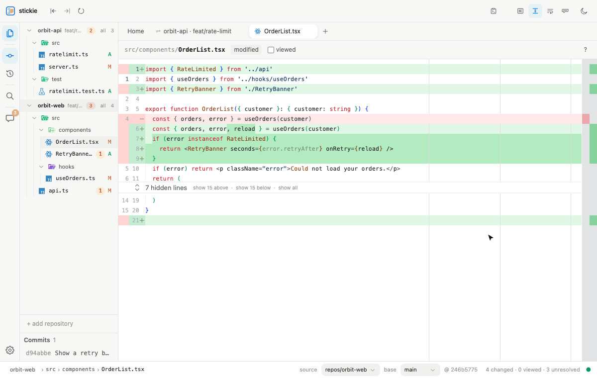
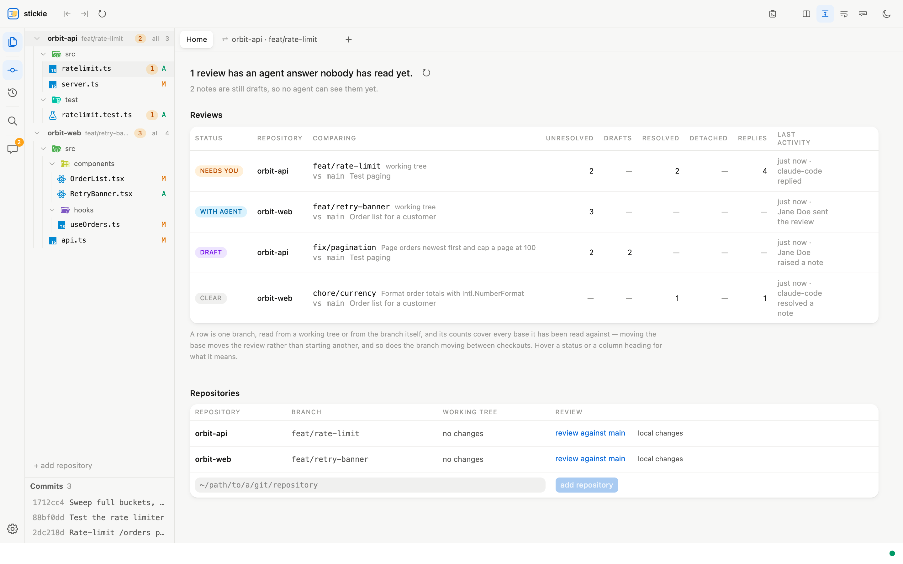
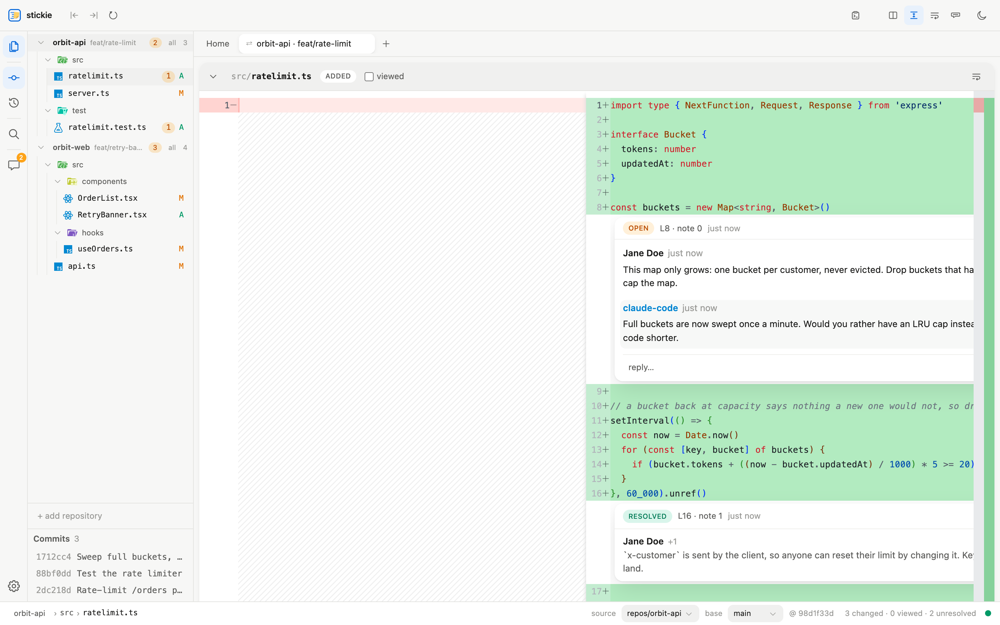
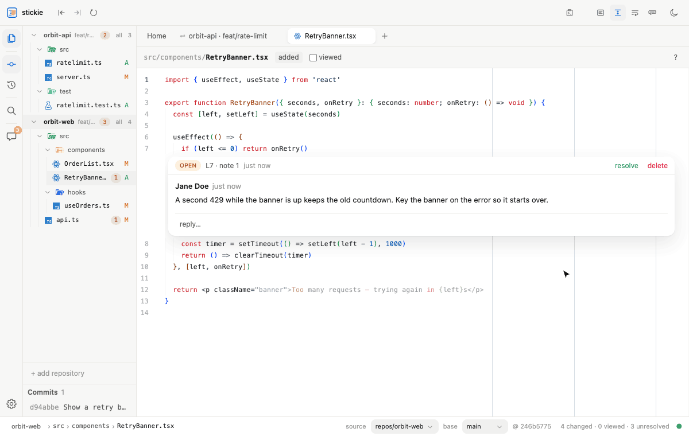
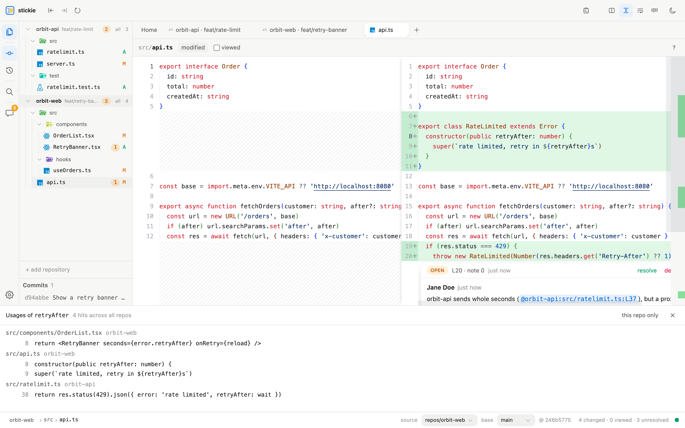
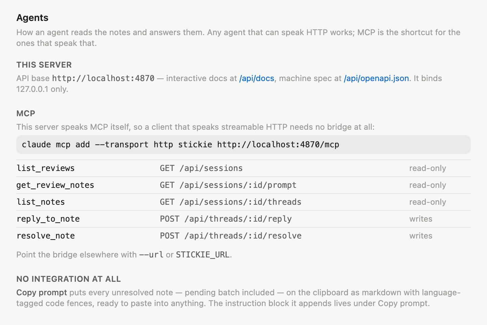
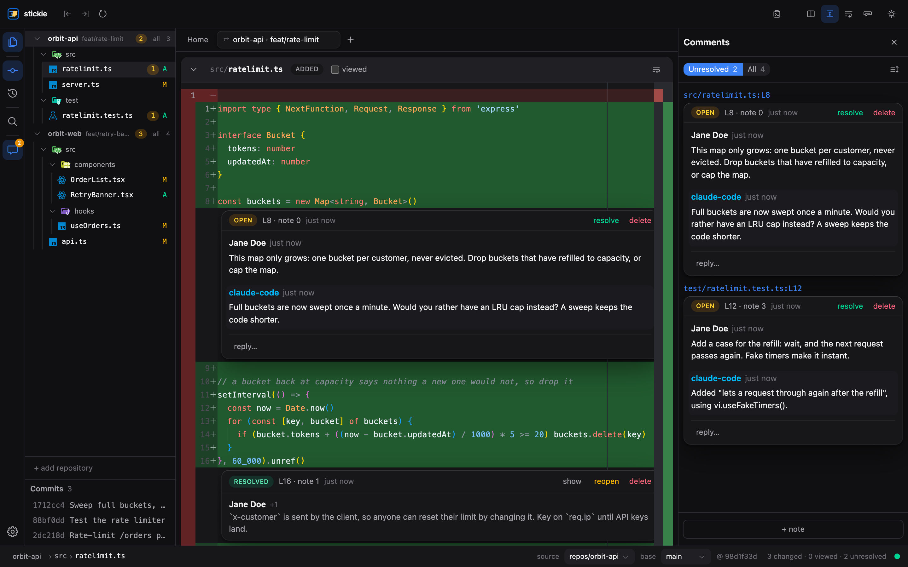

# stickie

**Notes for your coding agents.** Review what an agent changed the way you
would review a colleague: leave notes on the code. The agent reads them over
MCP or a plain JSON API, fixes what they ask, replies, and resolves — and you
watch it happen, without a reload.



A local, read-only review surface for changes made by coding agents. Open a
GitHub-style diff of any repo in your workspace — working tree, branch, or
worktree — and leave line-anchored notes anywhere, including on unchanged
code. Stickie never writes to your working tree; the notes are the only
output.

## Get it

```sh
npx stickie                 # from npm
uvx stickie                 # from PyPI — runs the npm package, so it needs Node 22+
```

or install the desktop app for macOS, Windows or Linux from the
[releases page](https://github.com/stickie-dev/stickie/releases) (see
[As an app](#as-an-app)). Release candidates, when there are any, are
`npx stickie@next` and `pip install --pre stickie`.

Then point your agent at it:

```sh
claude mcp add --transport http stickie http://localhost:4870/mcp
```

and ask it to *check the stickies*: list the reviews, read the open notes,
address each one, reply, and resolve.

## A tour

Every review in one place, sorted by what it is waiting for — *needs you*
when an agent has answered, *with agent* once you have submitted, *draft*
while you are still writing, *clear* when nothing is open.



The diff, with the conversation on the code it is about. The agent signs its
replies with its own name, and a resolved note folds away.



Notes cross repositories. While a note is open, select code in any
registered repository and *↗ ref* puts a link to it in the note; the link
opens that file at that line.



*Find usages* looks through every registered repository at once, for a
change whose blast radius does not stop at the repo it was made in.



The server speaks MCP itself. Five tools — list the reviews, read the notes,
list them, reply, resolve — over the same routes as the JSON API.



Light and dark, both built for reading diffs; the comments panel keeps every
note of the review in one list.



The repositories, code and people in these pictures are made up.

## Features

- **Overview** — the landing page. One row per branch under review — read
  from a working tree or from the branch itself — sorted by what it wants from
  you and labelled *needs you* / *with agent* / *draft* / *clear*, with note
  counts, agent round-trips, and what it compares as a short sha and commit
  subject rather than forty characters of hex. Moving the base keeps the same
  row, and so does the branch moving between checkouts. A review you are done
  with is archived from its row: it leaves the list and the list agents are
  given, keeps every note, and is brought back from *Archived* below — or by
  writing a new note in it. A review left alone — no note, reply or read
  mark, not opened, no commit on its branch — is archived after 60 days and
  deleted after 90, both set in Settings → Reviews; it sits in *Archived*
  for at least the difference first, a row says when it is due, and *keep*
  on the row exempts it. Deleting takes the notes and keeps the activity
  record of them. A draft review in another repository used to be invisible
  until you switched to it. Registered repositories are listed below the reviews:
  add one by path, and remove one you are done with — which deletes its reviews
  and notes, or keeps them out of the way so that adding the path back brings
  them again, whichever Settings → Reviews says, asked about by name and note
  count first either way. Clicking a registered repository starts
  a review of its working tree against the default branch — every commit on the
  branch you are on plus what is not committed yet, compared from where the
  branch left the default one, the way a merge request does — or, when you are
  already on that branch, browses the working tree
- **Continuous review flow** — every changed file stacked in one scroll
  (GitLab-style), sections mounting as they approach the viewport; or open
  any file on its own
- **Monaco diff review** — side-by-side or inline, full syntax highlighting,
  built from full file contents so every line is commentable, not just hunks
- **Tabs** — a persistent diff tab per repo that resumes its scroll position,
  a commit tab, and closable file tabs; file names carry only as much path as
  it takes to tell two of them apart, whatever does not fit moves into a
  dropdown rather than off the side, and the whole set comes back after a
  reload
- **Status bar** — the current path as clickable segments: each one opens
  what sits beside it (folders and files at that level) or copies the path,
  beside the review's tally — files changed, viewed, unresolved, draft
- **Linkable** — every tab has an address, and it names the *review*:
  `/r/631/file/src/store.ts?line=42` is that file at that line in review 631,
  so a link opens the same review for whoever follows it. Naming the repository
  instead meant a link opened whichever of its reviews the reader's own pickers
  had left active. Browser back and forward walk the tabs you opened. A note
  has an address too — `/r/631/n/3` is note 3 of that review: it opens the file
  the note sits on, marks the note, and keeps saying it is a note link until
  you move off it, while `?line=` on its own is just a line. Both resolve
  through the note's code rather than its stored line numbers, so a link keeps
  working as the code under it moves
- **Nothing lost on reload** — open tabs, viewed files, scroll position and
  half-written notes all come back, and leaving the review for settings never
  tears it down
- **Comment anywhere** — changed lines, unchanged lines, untouched files
  (the *All files* tab), base or source side, single lines or ranges, or no
  code at all: notes on a whole file or on the review itself
- **Review targets** — source is any worktree's working tree or any branch;
  base defaults to HEAD (worktrees) or the merge-base with the default
  branch (branches). A review *is* that pair: the commit its base is pinned to
  is state, not identity, so committing to the branch you are reviewing does
  not start a second review of it. Looking at one commit against its parent is
  a way of reading a review, not a review of its own
- **Live refresh** — file watching pushes updates over a websocket while the
  agent edits; the diff, note positions, and counters follow along, and notes
  the agent posts, answers, or resolves appear without a reload
- **Re-anchoring** — a note stores the lines *and* the code that was on them,
  and the code is the truth: on every read it is searched for again (exact,
  then ignoring indentation, nearest to where it used to be) and the stored
  line numbers are corrected to follow it. A note whose code vanished turns
  `detached` rather than pointing at whatever moved into its place. Both sides
  re-anchor, so re-pinning the base does not leave base-side notes behind.
  Resolved notes are frozen where they were written — they are history
- **Agent loop** — open notes via REST or MCP (`stickie-mcp`, five tools over
  the same routes), agent replies and resolves; or the zero-integration
  *Copy prompt* export — markdown, language-tagged code fences, in an order
  you can arrange — for pasting into anything. A note is named by its number
  inside its review, counting from 0, and that number is what replies and
  resolves take: *note 3 of review 631*, not a row id in the thousands that
  says nothing about which review it belongs to or how many notes are in it.
  Numbers are never reused, so one an agent was handed cannot come to mean a
  different note
- **Comments panel** — every note in the session in one list, in posting
  order, scrolling to new arrivals; notes still being written stay editable
  here while you browse elsewhere for references, and the prompt-order toggle
  shows the order *Copy prompt* emits, where notes are dragged into place
- **Multi-repo workspace** — every registered repository lives in one
  project tree (PyCharm attach-style); click into any repo's files, and
  cross-repo references (`@repo:path:L10`) capture naturally while a note
  is being written
- **Grep-grade navigation** — cmd/ctrl+click jumps to definitions
  (per-language regex heuristics over bundled ripgrep, no indexer daemon);
  right-click *Find usages* opens a hit panel, optionally sweeping every
  registered repo at once for cross-repo blast-radius checks
- **Review batches** — a note is a *draft* until you hit Submit review, so
  agents receive a finished review, not a stream. The submit control shows both
  choices — *Draft* or *Comment*, the emphasised one being what Enter does —
  and picking the other one remembers it, so the button always says what it
  will do. Per-note *post now* for one draft; Settings → Reviews for the
  default. (The API field is still `pending`, so no adapter breaks over a word.)
- **Commit timeline** — the commits list never moves the review target
  (the pickers do that): a click opens that commit against its parent in its
  own tab, and ⌘/shift+click adds commits as further columns, so one file
  reads left to right through the commits that touched it
- **Session continuity** — when the base moves past the pinned commit (the
  agent committed), the pin follows it: the review keeps every note, resolved
  history included, and both commits stay in the record. Automatic by default,
  because an agent committing mid-review is the normal case; Settings → Reviews
  can hold off while notes are open, or leave the pin to you entirely
- **A record of what happened** — every note raised, answered, resolved or
  deleted, every file marked read, every submission, re-pin and export, with
  who and when, in an *Activity* panel beside the diff. It is append-only:
  nothing rewrites it, and a deleted note leaves its record behind. It lives in
  the same database as the notes, so on a local SQLite file its owner can still
  edit it — a record, not proof, and stickie says so where you read it
- **Who wrote what** — notes carry a name, not just a role: yours as the
  reviewed repository's own git config knows you (local over global, the way a
  commit there would be attributed), or one name everywhere from Settings →
  Identity; an agent's from what it calls itself when it posts. There is no
  login and nothing is verified — it is a label on the record, which is all a
  local tool can honestly claim
- **Keyboard flow** — j/k files, n/p changes (across the whole flow, not just
  the open file), v viewed, ? for help; viewed files persist per session, and
  open tabs come back after a reload
- **GitLab MR import** — pull unresolved MR diff discussions into a local
  session (`GITLAB_TOKEN` + `GITLAB_URL` env), so agent fixes happen
  locally against real review threads
- **Find, and search** — ⌘F finds in what the tab shows: every file of the
  diff in the diff tab, the one file in a file tab. Pressed again while find
  is open it flips between the file you are in and the whole diff, and the
  find bar shows which. It counts the matches, walks them with ↵ and ⇧↵, and
  selects each one where it sits, opening only as much of a folded region as
  the match needs. ⌘⇧F, pressing Shift twice, or the Search button searches
  every registered repository instead; those results, and
  definition/usage hits, open in a read-only pane beside the diff, where
  selections feed refs into the note being written
- **Reading comfort** — light and dark themes built for diffs, soft wrap by
  file type (settings), per file (header button, right-click menu) or for every
  file in a diff at once, and width rulers at 80/100/120 on anything unwrapped
- **Where things are** — the top bar carries the review's own controls and the
  workspace's: source and base, search, the comments and activity panels, the
  theme, settings. The diff's own menu is the one at the end of the tabs — how
  it is drawn (side by side or inline, unchanged lines, wrapping) and what can
  be done with it (*Copy prompt*, which takes this review's notes to an agent)
- **Settings** — a page at `/settings` with a section each for identity, review
  behaviour (who moves a stale base pin), storage, GitLab instance and token
  resolution, the instruction block *Copy prompt* appends,
  appearance (theme and which file types wrap), and agents (this server's API
  address, the MCP command with your own path filled in, and the tool table)

## As an app

stickie runs in a browser tab, or as a desktop app of its own (Electron, in
`desktop/`) for macOS, Windows and Linux. The app runs the same server inside
itself on the same port, so a browser tab and an agent's MCP bridge reach it
exactly as they reach `stickie` from a terminal; its window is one more client.
If a `stickie` is already serving the port, the app uses it instead of starting
a second server over the same database, and a `stickie` started while the app is
open hands its repository to the app and opens a tab.

Closing the window either leaves stickie serving from the menu bar or quits it —
asked the first time, changeable in Settings → App, where the app also gives
the MCP command for itself (its own binary, run as Node, so no Node install
is needed).

```sh
pnpm desktop        # build, then run the app from the repository
pnpm desktop:dev    # the app on `pnpm dev`: client changes appear as saved
pnpm desktop:dist   # an installer for this machine, in desktop/release/
```

Working on stickie does not need an installer rebuilt: an installed app uses a
stickie already serving its port, the dev server included, and
`pnpm desktop:dev` shows Vite's page (`--dev=<url>` for another) so a saved
client change is in the window at once. In that mode the app starts no
server of its own, and waits for `pnpm dev` if it is not up yet.

An installed app is a copy of the build it was made from, so what reaches it
without a new installer depends on what changed:

- **The app itself** — `desktop/src` (the window, menus, tray, the close and
  port dialogs, the title bar), `desktop/assets`, `electron-builder.json`, the
  Electron version, the version number: only a new installer.
- **The server's dependencies**: only a new installer, since they are
  installed into it when it is built.
- **The server and the client**: a new installer for the app to serve them
  itself. While another stickie serves its port — the dev server, or `stickie`
  from a terminal — the app uses that server, its window shows that server's
  page, and the change is there without one.

So build one to use the app on its own, without `pnpm dev`, or after
changing the app or how it is packaged.

Installers are built on the platform they are for — the `desktop` workflow
does all four (macOS on Apple Silicon and Intel, Windows, Linux). They are
not signed: macOS asks before the first launch (right-click → Open).

A browser no longer offers to install stickie as its own web app. That install
could only ever be the browser's app, with the browser's buttons in its title
bar, and no browser lets a page point its install button at a real app; a
copy installed that way still works and says, in Settings → App, that it is
the old way.

## Run

```sh
pnpm install
pnpm build
pnpm start          # serves UI + API on http://localhost:4870
```

`node bin/stickie.js [path] [--port n] [--db file] [--no-open]` additionally
registers a repo (default: cwd) and opens the browser. During development:
`pnpm dev` (client on :5173 proxying to the server on :4870).

The port is 4870 unless set otherwise in Settings → App, which keeps it in
`~/.stickie/config.json` so `stickie`, the desktop app and the MCP bridge all follow
it; `--port` or `STICKIE_PORT` override it for one run. An MCP connector added
over HTTP has the address in it, so moving the port means adding that again —
Settings gives the command. Vite's port for working on stickie is
`STICKIE_DEV_PORT`, or `devPort` in the same file.

stickie never moves its port by itself. If the desktop app finds it held by
another program, it says which, and offers to try again once it is free, to
quit, or to run on the nearest free port *this time only*: the setting stays
as it was, and the window says that agents cannot reach stickie until it is
started on its own port again (a button there restarts it).

### What the builds leave

Four things are built from this repository — stickie run from the repository,
the npm package, its PyPI launcher and the desktop installer — and each leaves
its own folder; so does the script that draws this README's pictures.
All but the pictures are ignored by git and made again by the command that
made them.

| Folder | Made by | What it is |
| --- | --- | --- |
| `client/dist`, `server/dist`, `desktop/dist` | `pnpm build` | Each package compiled; `pnpm start`, `bin/stickie.js` and `pnpm desktop` run these. |
| `dist-pkg/` | `pnpm package` | The publishable npm package, with two binaries: `stickie` (the server) and `stickie-mcp` (the MCP bridge). Its dependencies are named, and installed by whoever installs it. |
| `python/dist/` | `uv build` in `python/` | The PyPI package: a launcher whose `stickie` and `stickie-mcp` run the npm package of the same version through `npx`, so `pip install stickie` or `uvx stickie` work wherever Node 22 does. Its version is read from `package.json`. |
| `desktop/stage/` | `pnpm desktop:dist` | The installer's contents, assembled: the three `dist` folders, and the server's dependencies installed as plain files, because pnpm's linked `node_modules` cannot be packed. |
| `desktop/release/` | `pnpm desktop:dist` | The installer (a `.dmg` on macOS) and the app unpacked beside it. |
| `docs/images/` | `pnpm showcase` | The pictures in this README, made from a made-up project; see CONTRIBUTING's "The README's pictures". Committed, unlike the rest. |

The server binds 127.0.0.1 only (`STICKIE_HOST` overrides). Nothing reaches
the network unless you press something: the GitLab import, and *fetch* in
the status bar, which runs `git fetch --all` for the repository in front.

stickie watches each repository's refs, so a commit, a pull or a checkout made
anywhere — a terminal, an IDE, an agent — is in an open review without a
reload; the reload button in the top bar is for anything it missed. The
dot at the end of the status bar says whether changes are reaching the page:
green, they are; amber, the server is not watching a repository it should
(it says which and why, and how to fix it, on hover — and retries by
itself); red, the page has lost the server. The
status bar marks a base or source branch that is behind or ahead of the
branch it tracks, as of the last fetch, and a branch only behind can be
pulled from there: a fast-forward, refused when it would have to merge or
would overwrite changes in the checkout it is in.

## Storage

Notes live in SQLite by default — one file at `~/.stickie/stickie.sqlite`
(`STICKIE_DB` overrides), no server to run. Point stickie at Postgres instead when
the record should outlive one laptop: paste a URL into Settings → Storage, or
set `STICKIE_DATABASE_URL`; a restart picks it up. The data-access layer is async
either way, so nothing above it knows which backend it is talking to, and
stickie never falls back on its own — an unreachable database is an error, not a
quiet detour into a local file.

A URL saved from Settings lands in `~/.stickie/config.json` (owner-only, and
shown back redacted). Prefer the environment variable on shared machines.

## API (agent-facing)

Interactive docs: **http://localhost:4870/api/docs** (Swagger UI); machine
spec at `/api/openapi.json`. The routes are defined with zod schemas, so the
spec is generated from the code and cannot drift.

| Method | Path | Purpose |
| --- | --- | --- |
| GET | `/api/repos` | registered repos |
| POST | `/api/repos` | register `{path}` |
| GET | `/api/repos/:id/targets` | worktrees, recent branches, default branch |
| POST | `/api/sessions` | get-or-create `{repoId, source, baseRef?}` |
| GET | `/api/sessions/:id/diff` | changed files |
| GET | `/api/sessions/:id/file?path=&side=` | full file content per side |
| GET | `/api/sessions/:id/threads?status=open` | notes, re-anchored |
| POST | `/api/sessions/:id/threads` | create a note |
| GET | `/api/threads/:id` | one note, re-anchored; no review id needed |
| POST | `/api/threads/:id/reply` | `{author, body, actor?}` |
| POST | `/api/threads/:id/resolve` · `/reopen` | close / reopen |
| GET | `/api/reviews/:id/notes/:number` | the same note, by its number in the review |
| POST | `/api/reviews/:id/notes/:number/reply` | `{author, body, actor?}` |
| POST | `/api/reviews/:id/notes/:number/resolve` · `/reopen` | close / reopen |
| GET | `/api/sessions/:id/prompt` | self-contained markdown export |
| GET | `/api/sessions` | every review, newest first |
| POST | `/api/sessions/:id/submit-review` | post the draft batch (`pending` in the API) |
| GET | `/api/repos/:id/file?path=&rev=` | any file, at any revision |
| GET | `/api/sessions/:id/activity` | the append-only record, newest first |
| GET | `/api/overview` | every review and repo, with what waits on whom |

The table is the agent-facing subset; Swagger lists the whole surface,
including the UI's own routes (navigation, settings, commit files, viewed
state, GitLab import).

## MCP

The running server speaks MCP itself, at **`POST /mcp`** — no bridge process,
no second port. Point any client that speaks streamable HTTP at
`http://localhost:4870/mcp`. (`GET /mcp` answers 405: stickie has no unsolicited
messages to stream.)

For clients that only speak stdio, `stickie-mcp` bridges to the same five tools:

| Tool | Route | |
| --- | --- | --- |
| `list_reviews` | `GET /api/sessions` | read-only |
| `get_review_notes` | `GET /api/sessions/:id/prompt` | read-only |
| `list_notes` | `GET /api/sessions/:id/threads` | read-only |
| `reply_to_note` | `POST /api/reviews/:id/notes/:number/reply` | writes |
| `resolve_note` | `POST /api/reviews/:id/notes/:number/resolve` | writes |

```sh
claude mcp add --transport http stickie http://localhost:4870/mcp
claude mcp add stickie -- node /path/to/stickie/bin/stickie-mcp.js   # stdio instead
claude mcp add stickie -- npx -y stickie stickie-mcp                 # once published
claude mcp add stickie -- uvx --from stickie stickie-mcp             # the same, from PyPI
```

Point it elsewhere with `--url http://host:port` or `STICKIE_URL`; it defaults
to `http://localhost:4870`. The bridge starts nothing — run stickie first.

See [agents/README.md](agents/README.md) for the integration guide and
[agents/claude-code/](agents/claude-code/) for a ready-made Claude Code
skill.

## Layout

- `client/` — Vite + React + Monaco UI
- `server/` — Hono API + static hosting; git via the CLI, and `server/src/db/`
  holding the async storage layer (SQLite by default, Postgres on request)
- `shared/` — types crossing the API boundary, consumed as source
- `agents/` — integration docs and per-agent adapters
